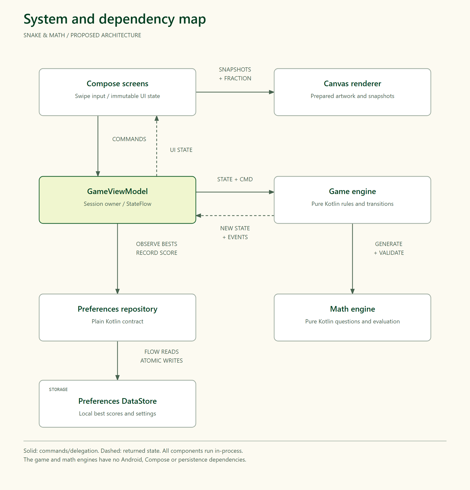
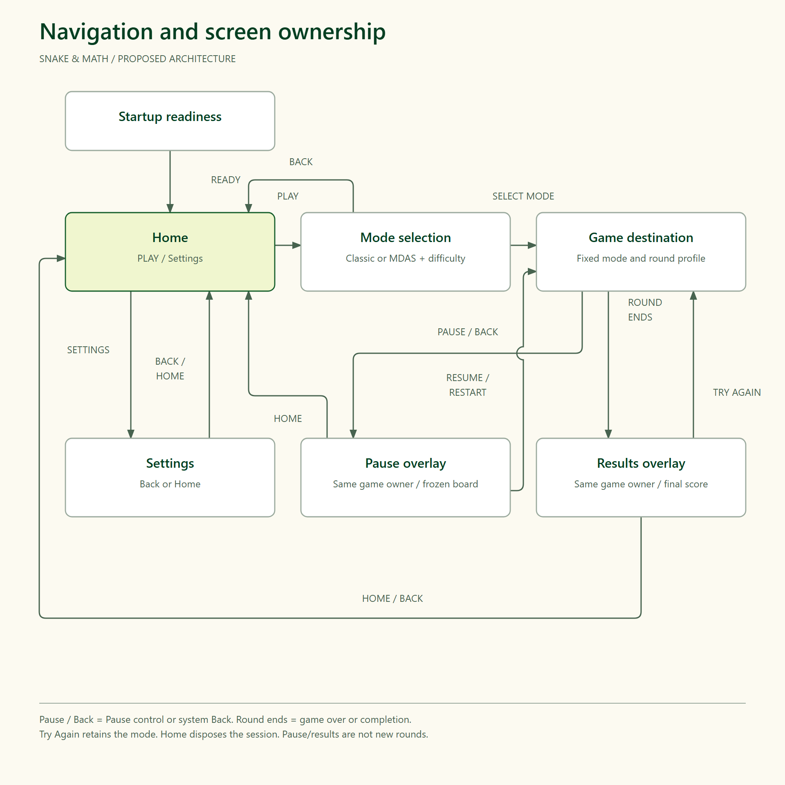
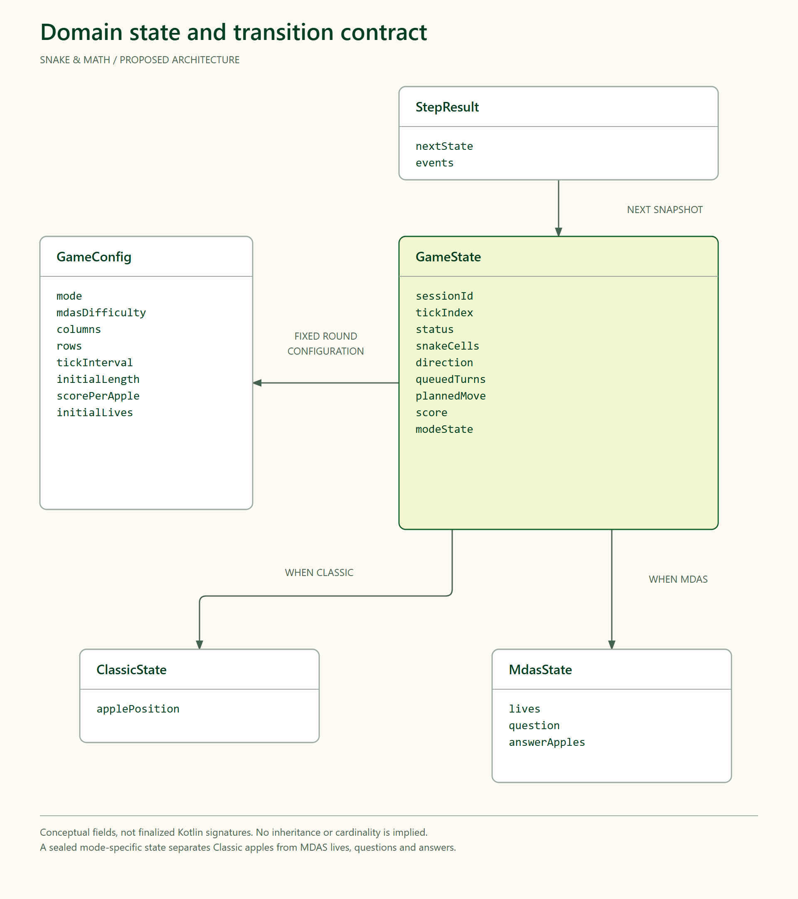
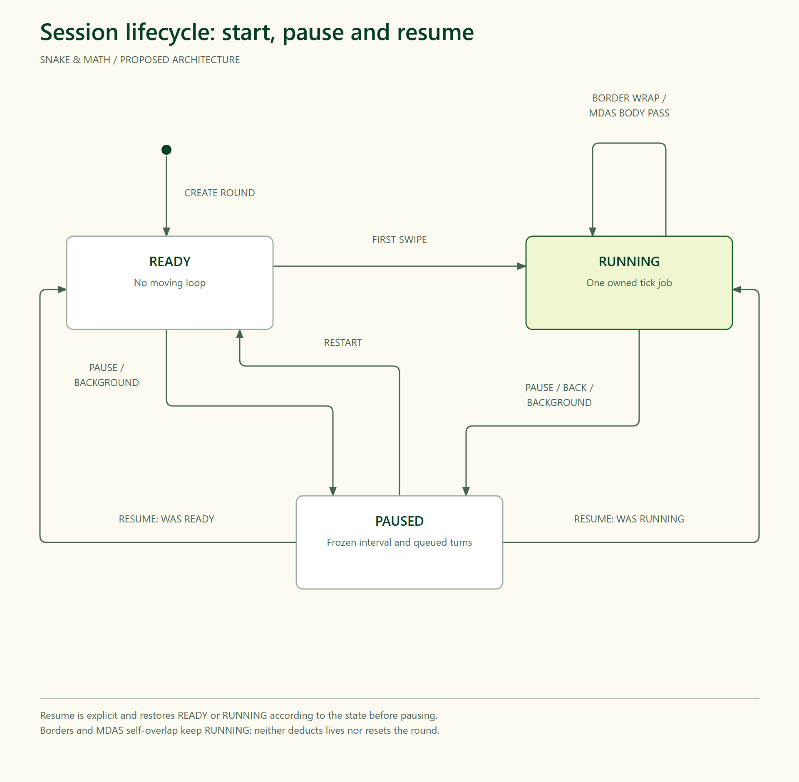
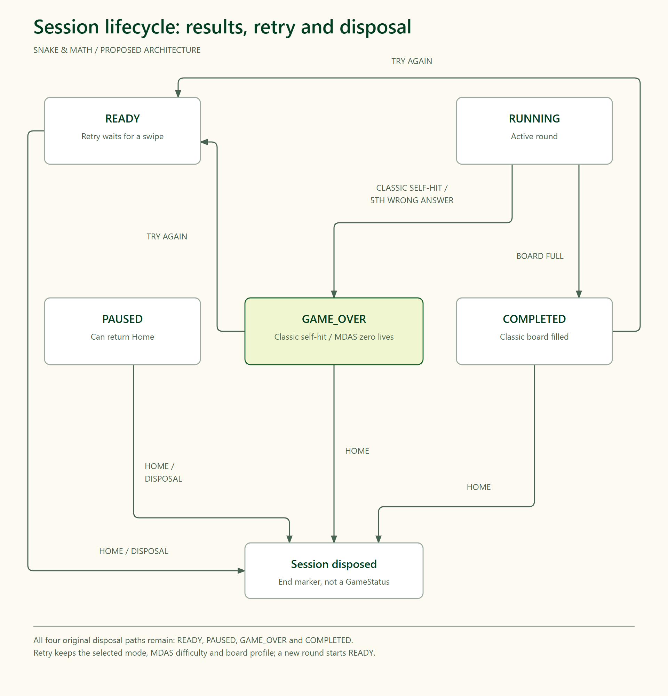
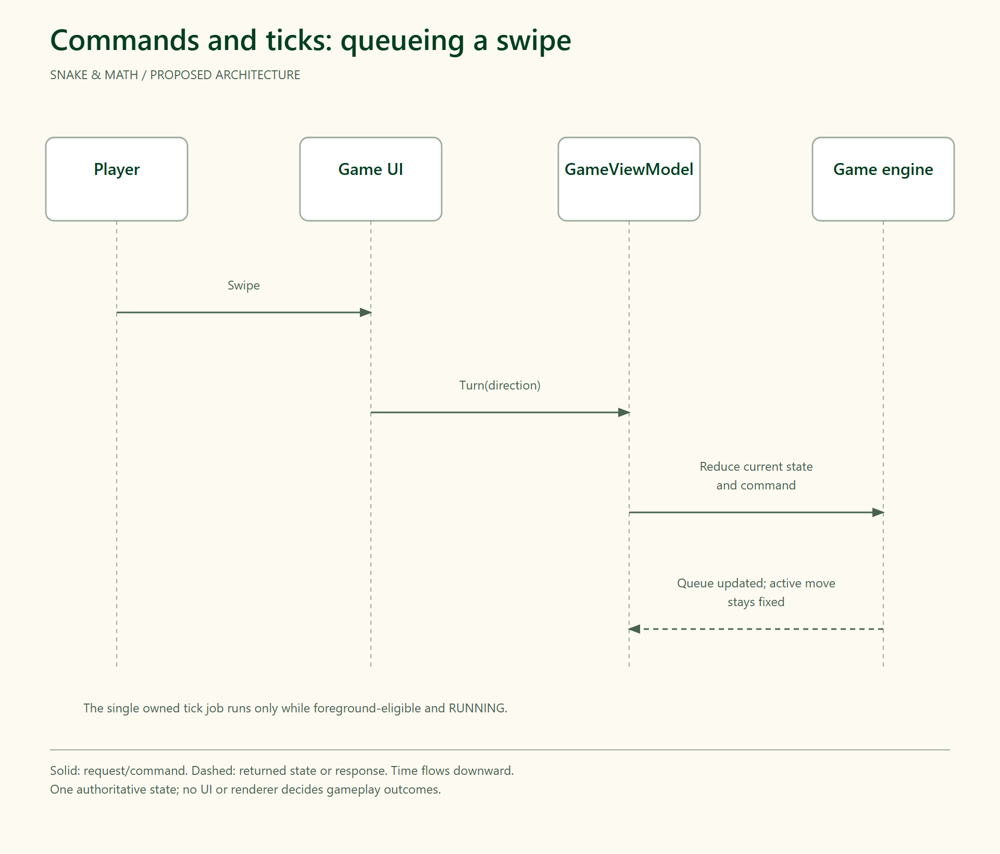
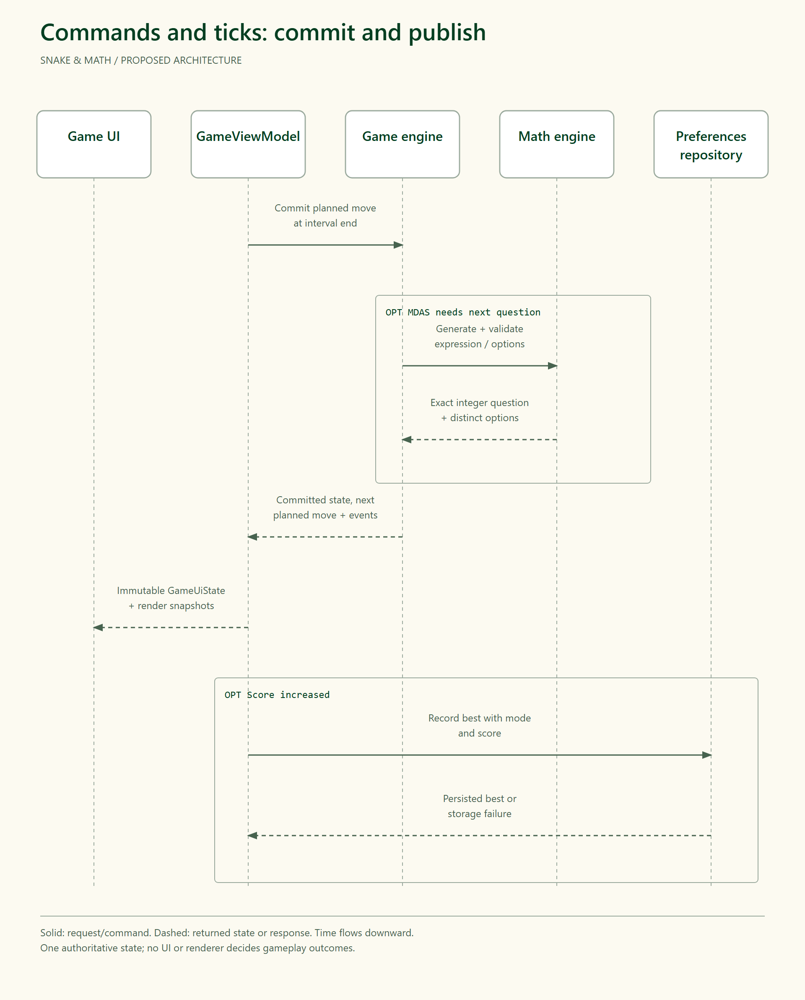
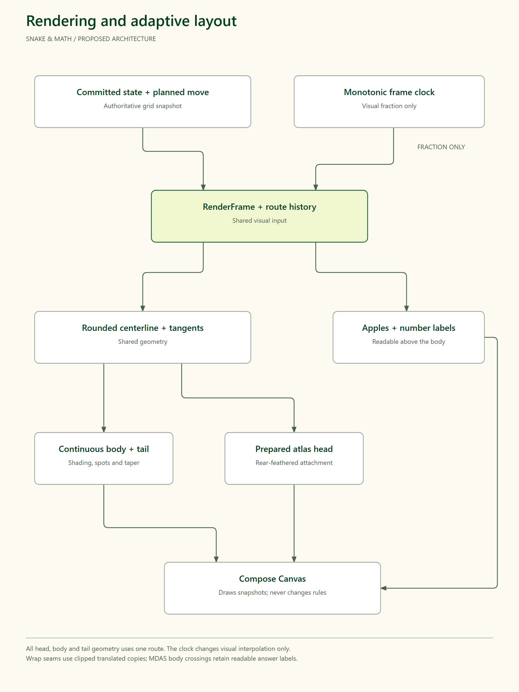

# Snake & Math — Android architecture

**Status:** Reconciled 2026-11-24. The native foundation includes T-004's theme, bundled assets/fonts, Home and typed Home/Modes/Settings navigation shell. See the [tracker](task-tracker.md) and [T-004 worklog](worklog/T-004-2026-11-22.md) for approvals, merge and verification coverage; broader device/Studio acceptance remains partial. The package contract is accepted through [DD-005](decisions/DD-005-package-structure.md), integration choices through [DD-007](decisions/DD-007-home-foundation-integration.md), and no-scroll Home through [DD-008](decisions/DD-008-home-fits-without-scrolling.md). Detailed gameplay construction, lifecycle, rendering and persistence APIs below remain proposals. Dev agreed [P-005](requirements/P-005-play-mode-gameplay-flow.md) / DD-009–DD-011 for the M1.7 entry foundation; [T-005](requirements/T-005-play-mode-gameplay-flow.md) is separately approved for `sol-medium` execution in a new Session B; the flow is not yet implemented.

**Read alongside:** [PRD](snake-math-prd.md), [Android handoff](android-prototype-handoff.md), [design system](design-system/README.md), [screen layouts](design-system/screen-designs.md).

**Diagrams:** All figures below are embedded PNG images, viewable directly in Markdown preview. [Editable sources and verification](diagrams/architecture-figures/README.md) are kept alongside them. The [interactive component diagram](diagrams/architecture.html) and its [specification](diagrams/architecture.json) remain optional references. Figures describe the proposed system; there is no backend, and their review status is unchanged.

## 1. Intent and boundaries

Build a maintainable native Android game that preserves the prepared screens and approved browser gameplay while making the rules independently testable. Compose owns presentation, Kotlin engines own rules, and a lifecycle-aware ViewModel owns each round. Screen layout and visual interpolation must never change logical game outcomes.

The existing screen galleries were inspected for both phone and tablet. They establish seven visual states: Home, mode selection, Classic gameplay, MDAS gameplay, pause, results and Settings. Pause/results preserve the game beneath a scrim. Phone gameplay stacks its HUD/question above the board; tablet gameplay places information beside the board. These are layout references, not seven independent game sessions.

The PRD fixes Kotlin, Compose/Canvas, MVVM, StateFlow, Coroutines and Preferences DataStore. This architecture retains those decisions. Home styling and smooth-joins v3 are approved references; screen extensions and loading motion are prepared proposals whose existing review status is unchanged by this document.

Version 1 includes both modes, selectable MDAS difficulty, swipe controls, local best scores and minimal sound/music preferences. Accounts, servers, online scores, saved rounds, themes, extra skins and automatic difficulty progression remain outside this design. It must work offline, avoid multiple loops, preserve one authoritative state and avoid replacing the approved snake with disconnected segment art.

## 2. Approach and decisions

| Approach | Trade-off | Decision |
|---|---|---|
| One `:app` module, feature packages, pure Kotlin engines | Simple setup and direct tests; package boundaries need review because Gradle does not enforce them | Use the PRD's initial structure |
| Separate Gradle modules for engine, data and features | Stronger compile-time boundaries; more build configuration and dependency wiring | Defer until actual size/reuse justifies it |
| Rules inside Composables or one large ViewModel | Initially fewer files; movement, rendering and lifecycle become difficult to test separately | Incompatible with the PRD's independent engine requirement |

The following are proposed engineering choices, not additional product approvals:

- Use one shared `GameViewModel` and gameplay composition parameterized by mode. Feature-specific HUDs and actions remain in `feature/classic/` and `feature/mdas/`.
- Treat pause and results as state-driven overlays inside the game destination. They share the same ViewModel and frozen board.
- Use explicit constructor injection; introduce a small application container only when concrete application-wide wiring needs it. Add no Hilt, Room, generic event bus or per-action use-case layer by default.
- Use a pure transition API: an input state and command produce a new state plus domain events. The ViewModel owns the current state; the engine has no independent mutable copy.
- Persist a best score when the score increases, rather than depending on the player reaching or leaving results.
- Start with a device profile derived from stable form-factor information; resize presentation independently and retain the round's selected grid.

These choices expand the PRD's recommendations into implementable boundaries without generating tasks or application code.

## 3. System and dependency map



This diagram shows proposed future gameplay runtime interactions. The interactive diagram shows call/delegation directions, with return values omitted for clarity. Future Home, Modes and Settings may consume preferences through route-level state owners; no such repository or ViewModels exist in the current shell. Current Home receives immutable values/callbacks and displays unavailable bests. Introduce observable owners when concrete data/behavior requires them, rather than creating every future owner now.

| Package/component | Owns | Must stay outside it |
|---|---|---|
| `app/` | Existing Activity, root composition and navigation; conditional future application container/lifecycle/device adapters | Game rules and drawing geometry |
| `core/model/` | Grid points, directions, mode, configuration, immutable game state, events | Android types and screen dimensions |
| `core/game/` | Command validation, ticks, turn queue, collision/growth/scoring/lives, placement and completion | Canvas, coroutine jobs and DataStore |
| `core/math/` | Structured expression generation/evaluation, exact division and unique options | UI text parsing, resource access and platform randomness |
| `core/ui/theme/` | Custom colors, type, dimensions and shapes from design tokens | Gameplay tuning and logic |
| `core/ui/components/` | Buttons, score panels, lives, question card, backgrounds | Repository access and state transitions |
| `core/ui/drawing/` | Board geometry, route smoothing, interpolation, continuous snake, apples and labels | Collision checks, answer evaluation and scoring |
| `data/repository/` | Preferences contract and implementation mapping | Active round ownership |
| `data/preferences/` | A single Preferences DataStore instance, keys and storage error handling | Navigation and game rules |
| `feature/` | Route-level ViewModels, screen state, screen content and UI event forwarding | Persistence APIs in Composables and duplicated engines |

Allowed dependency direction is presentation → core models/engines and repository contracts; repository implementation → preferences storage; drawing → core models. Repository contracts expose plain Kotlin values/Flow, not DataStore types. Core models do not depend on engines or presentation. Game logic may use math and shared models; math may use shared models. Engines never depend on `app`, `feature`, `core/ui`, `data`, Android or resources. Avoid circular package dependencies. These boundaries require review inside the single module; no new build enforcement is added.

## 4. Package structure and construction

The namespace/application ID is `com.acp.snakemath`, accepted in [DD-001](decisions/DD-001-application-identity.md). This is the canonical package map for the existing single `:app` module. Existing production packages are `app/`, `app/navigation/`, `core/ui/theme/`, `core/ui/components/` and `feature/home/`. Other entries are planned responsibilities; create each directory only when approved work adds its first useful file. Do not add empty classes, package READMEs or placeholder files to populate this tree.

```text
app/src/main/java/com/acp/snakemath/
├── app/
│   ├── MainActivity.kt           # Existing: launcher and Compose host
│   ├── SnakeMathApp.kt           # Existing: stateless root and private preview
│   ├── AppContainer.kt           # Planned, conditional: application-wide wiring
│   ├── navigation/              # Existing: typed Home/Modes/Settings shell
│   └── device/                  # Planned, conditional: platform adapters
├── core/                        # UI foundation exists; domain engines planned
│   ├── model/                   # Immutable shared grid/domain values
│   ├── game/                    # Movement, turns, collisions, spawning, score/lives
│   ├── math/                    # Arithmetic generation/evaluation and answers
│   └── ui/
│       ├── theme/               # Existing: custom colors, typography, dimensions
│       ├── components/          # Existing: Home/shared foundation presentation
│       └── drawing/             # Canvas geometry, interpolation, prepared artwork
├── data/                        # Planned
│   ├── repository/              # Repository contracts and implementations initially
│   └── preferences/             # DataStore construction, keys and storage mapping
├── feature/                     # Home exists; other features planned
│   ├── home/                    # Existing: stateless Home and immutable UI state
│   ├── modes/                   # Mode selection presentation
│   ├── game/                    # Shared game owner/host and pause presentation
│   ├── classic/                 # Classic HUD/content
│   ├── mdas/                    # Question/lives HUD/content
│   ├── settings/                # Settings presentation
│   └── results/                 # Results presentation
└── MainApplication.kt           # Planned, conditional: application-wide setup
```

`MainApplication.kt`, `app/AppContainer.kt` and `app/device/` are conditional on concrete needs in future approved setup/device/lifecycle tasks. Their appearance here does not require creation or approve construction APIs. The existing Activity, stateless root and private `SnakeMathAppPreview` stay in `app/`.

Section 3 defines responsibilities and allowed dependency directions. Models and game/math engines remain pure Kotlin without Android, Compose, resource or persistence dependencies. Drawing consumes snapshots/models and never decides gameplay outcomes; reusable components forward events without repository access. Feature packages own presentation and appropriate route-level ViewModels, without duplicating the shared game session.

Tests mirror production packages under `app/src/test/java/com/acp/snakemath/` or `app/src/androidTest/java/com/acp/snakemath/`. Current instrumented tests cover the launcher, navigation, Home fit/behavior and shared rendering/title regressions; JVM tests remain `NO-SOURCE` in the recorded T-004 run. Bundled fonts are in `app/src/main/res/font/`; the approved Home mascot/background are in `app/src/main/res/drawable-nodpi/`, following the [asset allowlist](assets/README.md) and [font provenance](assets/font-sources.md). The gameplay atlas has not been imported.

Detailed construction remains proposed: an application container, if needed, could construct the preferences repository/DataStore and engine factories, with a ViewModel factory creating one game owner per game back-stack entry. Engines receive explicit configuration and injectable randomness; screen content receives values/callbacks, and future route-level code obtains ViewModels and collects flows where needed. Game construction, ViewModel and route APIs need their own approved tasks; reuse the existing navigation host rather than reinitializing it. A future module split remains deferred; package boundaries currently rely on review.

## 5. Navigation and screen ownership

**Implemented shell:** One Activity and Navigation Compose 2.9.7 with serializable Home, Modes and Settings routes. Home is the start; PLAY and Settings lead to temporary destinations. Originating-entry guards and typed non-inclusive return to Home protect repeated/stale callbacks. Modes has no choices yet, and no Game destination/session exists.

**Agreed M1.7 target, ready for Session B:** [P-005](requirements/P-005-play-mode-gameplay-flow.md) and [DD-009](decisions/DD-009-m17-navigation-foundation.md) accept mode cards, non-playable mode destinations and explicit placeholder Back/Home behavior. [DD-010](decisions/DD-010-mdas-entry-difficulty.md) accepts inline Easy/Medium/Hard, initially Easy; retain selection while returning to the same Modes entry and across ordinary Activity recreation, reset it after Home. [DD-011](decisions/DD-011-shell-process-restoration.md) accepts new-process return to Home, including saved-task relaunch. These are accepted target behavior, not claims about the current host. T-005 is the separately approved implementation task, with `sol-medium` selected by Dev.

**Future playable target:** Add Game(mode, difficulty) to the existing host. Difficulty applies only to MDAS and is selected before creating the round; Classic does not use an arithmetic level. Extend the existing typed route approach. Mode/difficulty are route data; mutable game state is never a navigation argument. Difficulty-selection UI must be agreed before selection implementation tasks are drafted; numeric generation bounds must be agreed before generator work.



The table and figure describe future integrated gameplay ownership, not classes/routes already present or an approved requirement to scaffold them now.

| Visual screen | Proposed future state owner | Data and behavior |
|---|---|---|
| Home | `HomeViewModel` | Both repository best scores in the existing best-score panel, clearly labeled Classic and MDAS; PLAY and Settings navigation. Both values also appear in Modes |
| Mode selection | `ModesViewModel` | Both persisted bests; selected MDAS difficulty; starting a mode creates a fresh round |
| Classic gameplay | Shared `GameViewModel` | Classic engine state, score/best, one apple, pause and swipe commands |
| MDAS gameplay | Same shared owner, selected MDAS mode | Five-life state, persistent expression, three answer apples and feedback |
| Pause | Existing game owner | Frozen board; Resume, Restart and Home. No second loop or navigation entry |
| Results | Existing game owner | Final score, effective best and result reason. Retry replaces the round in place |
| Settings | `SettingsViewModel` | Sound/music settings as observable repository data; writes persist across restarts |

Back from a ready/running round opens pause; Back while paused leaves the pause controls visible so exit is explicit. Back from results returns Home. Returning Home removes the game destination instead of leaving a live session behind it. Starting another mode creates another session ID; retry/restart retains the existing mode, MDAS difficulty and board profile, resets score/lives/turns, and waits for a swipe.

Startup is application readiness, not another persistent navigation destination. The proposed animated loading composition is conditional on approval and real pending work. Read preferences asynchronously; show an unresolved score/loading state rather than presenting a fabricated persisted value. No forced minimum duration. Process death starts a fresh Home flow, even if the navigation library can restore a previous Game route; active sessions are deliberately not restored.

The user confirmed on 2026-11-20 that Home displays both mode best scores, clearly labeled. Preserve the supplied panel styling while giving each value a mode label; illustrative single-value mockups do not override this binding. Detailed system-Back behavior above is an engineering proposal to check during architecture review, not a newly approved mockup change. THEMES remains deferred and has no destination.

## 6. Domain state and transition contract

The ViewModel holds one immutable `GameState`. Screens and Canvas receive snapshots, never a mutable engine handle. `GameEngine.create(config, random)` produces a ready state; `GameEngine.reduce(state, command, random)` produces a `StepResult(state, events)`. These names describe contracts rather than code already present.



Use a sealed mode-specific state so Classic cannot accidentally expose an MDAS question/lives field. The math engine returns a question with a structured expression, correct value and three unpositioned options (stable IDs and distinct integer values). The game engine owns `answerApples`, a separate list mapping each option ID to exactly one grid position. Positions are stored only in that list, never duplicated inside the question. Presentation joins values to placements by option ID and styles all options identically. Generate/evaluate tokens or an expression tree, not executable expression strings. Format `×` and `÷` for display separately.

The native math engine receives the selected difficulty profile from fixed round configuration. Use the PRD's Section 2.2 as the source of truth: Easy guides ages 6–7, Medium 8–9 and Hard 10–12, with operation counts and learning goals defined there. These are selectable skill levels, not age gates. The browser's single mixed-operation pool does not define native Easy/Medium questions. Operand/result/distractor bounds still need agreement before generator implementation; do not treat the prototype's potentially negative distractors as an approved range for every child-focused profile. Best scores remain per mode as currently specified; per-difficulty score records are not introduced by this change.

Baseline configuration follows the handoff: six-cell starting snake facing right, 240ms ticks, +10 per correct collectible, five MDAS lives, at most two queued turns, phone 12 × 16 and tablet 20 × 16. Tuning values belong in `GameConfig`; Android density and visual body width do not.

Commands include turn, tick, pause, resume and restart. An immutable `PlannedMove` records the selected direction, next cell, collectible reference, growth flag and collision result for the current interval; only the engine calculates it. Late swipes cannot rewrite that in-flight move. Engine status is authoritative: `READY`, `RUNNING`, `PAUSED`, `GAME_OVER`, `COMPLETED`. A pause retains whether it came from READY or RUNNING; resume restores that state so pausing before the first swipe does not accidentally start movement. Both modes wrap at borders. Only Classic body occupancy can produce a lethal collision plan; MDAS body overlap is normal movement and never re-enters READY, resets the snake/question or deducts lives.

Events describe transitions such as apple collected, correct answer, wrong answer, life lost, pose reset and terminal result. UI state retains user-visible feedback with an event identifier so recomposition does not replay it. Persistent scores derive from authoritative score snapshots, not a lossy event stream. Optional sound consumers may consume events later; playback is not implemented by the settings switches themselves.

## 7. Session lifecycle

**Start, pause and explicit resume**



**Results, retry and disposal**



A lifecycle adapter reports foreground eligibility to the ViewModel; the ViewModel does not hold an Activity, LifecycleOwner or Context. Losing the resumed/interactive lifecycle pauses an active round, cancels the tick job and freezes the current visual phase. Retain the planned move, turn queue and elapsed active interval time in memory, as the prototype does. Pause is idempotent. Returning to the foreground never automatically resumes a paused game.

The pause overlay may resume only while the destination is active and foreground-eligible. A ViewModel surviving Activity recreation retains the paused in-memory round. A new process has no round to recover. Repeated lifecycle events, retry and rapid taps must not create additional clocks.

## 8. Commands, ticks and concurrency

All game commands and tick commits are serialized on the ViewModel's main execution context. Reduction is synchronous and bounded; persistence is asynchronous and never runs inside a transition. UI commands and ticks cannot mutate the same state concurrently. Use session ID and loop-generation guards to discard stale work after restart/disposal.

There is at most one tick `Job`. Starting checks its ownership; stopping invalidates the generation and cancels it before a replacement is eligible. READY has no moving loop. A first valid swipe selects the direction, plans the first move and enters RUNNING; its cell commit occurs after one tick interval. Swipes during the interval queue turns for following intervals, validating against the last queued direction or the active planned direction. Pausing retains pending turns and the frozen interval fraction; explicit resume schedules only the remaining active duration. Time spent paused/backgrounded is excluded. Recomposition and UI flow subscriber counts do not start or stop the logical game implicitly.

At interval start, the engine selects at most one queued direction, wraps the destination coordinates into the fixed board and plans collection/growth. Check body occupancy only in Classic, with the correct vacating-tail rule; a wrapped destination can still hit the Classic body. MDAS body cells never block movement, even when multiple ordered segments share a cell. The renderer can animate this plan, but score, cells, lives and collectibles remain uncommitted until interval end. Tick processing commits the fixed plan, applies collection/lives rules and generates replacement collectibles/questions if needed. If still RUNNING, the same atomic transition then selects the next queued turn and plans the following interval. The UI cannot observe half a new question with old answer apples, and a swipe late in an interval cannot bend travel already shown on screen.

On a delayed wake-up, advance one cell and schedule the next interval from the current monotonic time. Do not execute a burst of missed ticks. Tick delay and randomness are injectable for deterministic tests; browser timing thresholds are calibration references rather than Android pixel measurements.

**Queue the input**



**Commit the tick and publish state**



An incorrect MDAS answer deducts exactly one life and, if lives remain, replaces the question without growth or a pose reset. Self-overlap alone changes neither lives nor question/apples, score or status; normal movement continues. A terminal MDAS result occurs only when an incorrect answer reduces lives to zero. A body crossing can still collect an apple, which uses the normal answer rule.

Reachability uses wrapped neighbors. Classic apple spawning uses reachable unoccupied cells: full distinct-cell board coverage completes the round before spawning; otherwise retain the existing no-penalty fairness-pose fallback if no reachable free cell exists. That Classic-only fallback restores starting heading, clears turns, preserves score and remains RUNNING.

MDAS has no body obstacles or trapped-pose reset. Place three answers on distinct cells excluding the head; prioritize body-free cells, then use body-occupied cells if fewer than three clear positions exist. Keep apple labels above the body. Ordered body entries can repeat positions, so a set of occupied cells is only a derived placement aid, never a replacement for snake length/order. Body coverage, repeated overlaps and lack of body-free space cannot introduce a new MDAS game-over/reset condition.

## 9. Rendering and adaptive layout

The renderer takes a `RenderFrame`: the current committed cells, engine-produced planned move, active interval fraction and enough visited route history to preserve the approved head/body/tail path. It interpolates forward from the committed pose toward that fixed plan, matching the browser, rather than lagging between two already committed snapshots. For a lethal Classic self-collision plan, hold head/tail positions until the interval commits the collision while retaining the prototype's head-rotation easing; for growth, advance the head while holding the tail. MDAS body crossings interpolate normally. Engine data remains grid-based; renderer caches derive geometry without feeding it back into rules. Restart and the Classic-only fairness pose reset replace visual history and reset the fraction rather than animating across the board. Borders and MDAS body crossings never clear visual history.



Wrap-around requires a native extension to the non-wrapping browser route: retain unwrapped/lifted path coordinates or explicit seam metadata, then draw translated copies clipped to the board. A rightward move from the last column continues right beyond that boundary and reappears at the left, rather than connecting the two cell centers with a line through the field. All head/body/tail copies use the same route and tangents. Clip visible art at the playable boundary; verify head and tail wrapping independently and during turns. MDAS self-crossings may overlap geometrically; draw answer apples/numbers above the body and the head above the apples. Retain enough ordered route history for the actual snake length, including repeated cells, rather than truncating it at board area. Long-session memory/frame cost needs profiling without adding an unapproved MDAS length limit, penalty or reset.

Visual ticks interpolate at display cadence independently of logical ticks. Tail travel stops on growing ticks. The renderer follows [smooth-joins v3](assets/game/path-snake/smooth-joins-v3.md): bounded rounded turns, local cross-section shading, sparse clipped spots, integrated taper and the original head region. All parts share one route/tangent calculation. Art width, tongue and shadows never enlarge collision cells.

Crop/feather the gameplay head once; decode approved assets once and reuse them. Bundle Baloo 2 ExtraBold/Nunito Bold. Use the design system's custom token objects/CompositionLocals, procedural apple drawing and readable answer labels. Frame progression should invalidate drawing rather than recomposing every HUD element. Cache paths/brushes where useful and profile actual device performance before claiming smoothness.

Define two related concepts:

- **Device profile:** proposed `smallestScreenWidthDp >= 600` tablet-like classification at round creation; selects portrait/12 × 16 or landscape/20 × 16. It is not derived from whichever dimension happens to be the current window width. Foldables follow their current stable form factor for a new round.
- **Window layout:** current available bounds/insets determine whether the HUD stacks or uses a rail and the actual pixel size of square cells. A narrow resized tablet window may use a stacked fallback while retaining its 20 × 16 round.

Request the PRD's phone-portrait/tablet-landscape orientation at the Activity boundary consistently across navigation. Native classification/enforcement needs tests. Android 16 documents large-screen orientation overrides and an exception for applications categorized as games; mark the app appropriately at initialization and verify against the chosen target SDK. OEM/window policies may still override orientation. Treat this as a platform constraint: fit the fixed board and retain playable controls/question text even if a requested orientation is not honored. Do not change grid dimensions or stretch cells to compensate. See [Android 16 behavior changes](https://developer.android.com/about/versions/16/behavior-changes-16) and [Activity orientation behavior](https://developer.android.com/guide/topics/manifest/activity-element).

The fallback is defensive behavior, not a relaxation of the PRD's orientation acceptance. On supported phone/tablet configurations, the requested lock must hold across navigation and rotation. If the platform prevents that, record an orientation acceptance failure separately from layout usability; resolve supported-device scope or obtain a product exception before release. A usable fallback alone does not count as passing the lock requirement.

Use safe-area insets, a bounded board and scalable HUD layout. On resizing/form-factor change, retain the current round profile; pause when the host is no longer interactive. A new round started from mode selection can select the new form factor. Accessibility labels cover buttons/lives/score and polite feedback; swipe-only gameplay remains a product constraint rather than a claim of full screen-reader accessibility.

## 10. Preferences and side effects

| Stored value | Behavior |
|---|---|
| Classic best | Non-negative integer; atomic maximum on each Classic score increase |
| MDAS best | Separate non-negative integer; atomic maximum on each MDAS score increase |
| Sound effects enabled | Boolean preference observed by Settings and any future sound adapter |
| Music enabled | Boolean preference observed by Settings and any future music adapter |

Proposed fresh-install defaults follow the review: effects enabled, music disabled, both bests zero. Keep defaults centralized and reviewable. A snapshot result uses `max(observedPersistedBest, roundScore)` immediately while storage completes. Update the stored best inside DataStore's transaction using its current value, not a stale UI value.

One application-owned DataStore backs a `Flow<UserPreferences>`. The repository provides reads and suspend write operations; ViewModels never access keys. Best-score writes use an application-owned structured scope so leaving a game does not cancel an already scheduled update. The repository owns this scope, exposes errors, and does not retain a ViewModel/Activity. Process termination may still interrupt a pending write; this is local persistence, not a guaranteed transaction across app termination.

Distinguish first-load state from loaded defaults and I/O failure. Preserve the current round and in-memory best when storage fails; expose a recoverable preference error and retry rather than overwriting stored scores with zeros. Settings shows write failures rather than implying a successful save. No active snake, answer positions, turn queue or round timer is written to DataStore or saved-instance state.

Audio playback is a later platform adapter consuming settings and domain events. It must stop appropriately in the background and release resources. No audio assets or playback approval are assumed here; persistent toggles must not be described as audible behavior until that adapter and assets exist.

## 11. Verification contracts

These define the evidence the eventual task plan must obtain; they are not implementation tasks or claims of passing native checks.

| Boundary | Required evidence |
|---|---|
| Game engine | Four-edge/corner wrap, queued/reverse turns, growth, wrapped Classic self-hit and vacating-tail cases, Classic-only reachable-spawn/fairness reset and full board, MDAS repeated-cell pass-through without penalty/reset/question change, distinct answers under dense body coverage, life loss only for incorrect answers |
| Math engine | Selected profile's operation/count and agreed numeric bounds, precedence, equal-precedence left-to-right evaluation, exact nonzero division, one correct/two distinct distractors, randomized positions with seeded generation |
| ViewModel/loop | First-swipe start, one loop across retry/resume, stale tick rejection, serialized commands, interval-start planning/late swipe deferral, pause-before-start behavior, frozen phase/queue across background pause, explicit resume, cancellation and no catch-up burst |
| Preferences | Separate monotonic bests, atomic maximum under competing writes, defaults, settings updates, initial-load/error states and recoverable I/O failures |
| Navigation/UI | PLAY → Modes → selected mode, swipe-only controls, mode-preserving restart, overlays retaining frozen state, Home disposing the session, Back behavior and process-death fallback |
| Layout/device | All screen references on phone/tablet, fixed 12 × 16 / 20 × 16 grids, square cells, insets/font scaling, visible expression/three labels, orientation locks across navigation/rotation on supported devices, plus separately evaluated resizing fallback |
| Renderer | Straight/turning/short/long/four-direction inspection scenes; several forward-planned interpolation phases including growth/Classic collision freeze, boundary clipping/translated wrap copies, MDAS self-crossings with visible answer labels, no head/neck/tail seams, and actual native frame timing |

Use local JUnit tests for pure engines and coroutine tests for ViewModel scheduling. Compose tests exercise screen behavior with injected state/repositories; device tests cover lifecycle, orientation, gestures and actual rendering. Compare native scenes with approved v3 stills. Browser evidence does not replace Android tests or performance measurements.

## 12. Decisions left for initialization and review

- Foundation decisions are accepted: [DD-001 identity](decisions/DD-001-application-identity.md), [DD-002 minimum Android](decisions/DD-002-minimum-android-version.md), [DD-003 build baseline](decisions/DD-003-foundation-build-baseline.md), [DD-004 Compose configuration](decisions/DD-004-compose-configuration.md) and [DD-005 package contract](decisions/DD-005-package-structure.md). T-002 established the native Compose foundation; consult its [worklog](worklog/T-002-2026-11-21.md) and current build files for actual versions and verification evidence.
- T-004 added the theme/navigation/Home foundation under [DD-007](decisions/DD-007-home-foundation-integration.md). Preserve [DD-008's no-scroll Home](decisions/DD-008-home-fits-without-scrolling.md), current component styling and the user-requested tighter multiline title (`0.8.em`), documented in its [worklog](worklog/T-004-2026-11-22.md). Reference mockups do not override those corrections.
- Home best-score meaning is confirmed: show both Classic and MDAS with labels. Fresh-install sound/music defaults and system-Back behavior remain explicit engineering proposals for architecture review.
- The MDAS age bands/skill levels are confirmed. Final numeric bounds and the difficulty-selection UI within the prepared flow need definition before generator/selection implementation tasks.
- Native swipe threshold, font scaling, renderer sampling density and visual tuning are implementation calibrations against the supplied references.
- Loading-motion approval, production audio/icon/logo assets and publication provenance remain tracked in the existing design/asset documents. Do not invent their approval or expand runtime asset allowlists.

T-005 is separately approved for agreed P-005 and ready for a new Session B using Dev-selected `sol-medium`. This approval covers the M1.7 foundation only; it does not approve other gallery screens or the remaining detailed gameplay architecture. Keep API 23/API 36/rotation/Studio/visual gaps open in the tracker/worklog.

## 13. Reference precedence and external guidance

1. Latest user decisions and [PRD](snake-math-prd.md) establish product scope and device profiles.
2. [Android handoff](android-prototype-handoff.md) records the browser baseline and subsequent native rule changes. The [current grid prototype](assets/game/snake-grid-gameplay-prototype.html) retains historical wall/self-collision behavior; it does not implement the newly confirmed wrap-around/MDAS pass-through rules or difficulty profiles.
3. [Smooth-joins v3](assets/game/path-snake/smooth-joins-v3.md) governs the moving snake; static mockup snake art cannot override it.
4. [Design tokens/components](design-system/README.md), approved mockups and prepared [screen layouts](design-system/screen-designs.md) govern presentation within their documented review status.
5. [Asset allowlist](assets/README.md) determines runtime artwork candidates.

Platform guidance was checked when writing this proposal. StateFlow-driven UI, unidirectional flow and lifecycle-aware collection follow [Android architecture recommendations](https://developer.android.com/topic/architecture/recommendations) and [Compose state hoisting](https://developer.android.com/develop/ui/compose/state-hoisting). Drawing-phase state reads follow [Compose phases](https://developer.android.com/develop/ui/compose/phases). These platform recommendations support the boundaries above; the game-specific transition, navigation and timing choices are proposals in this document.
