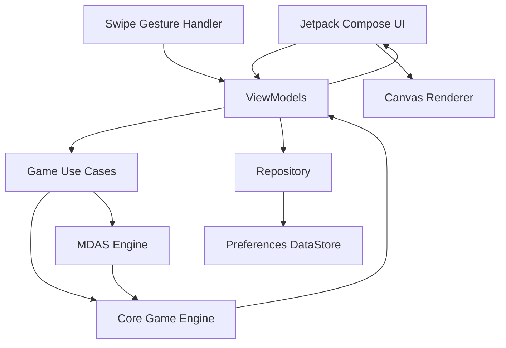
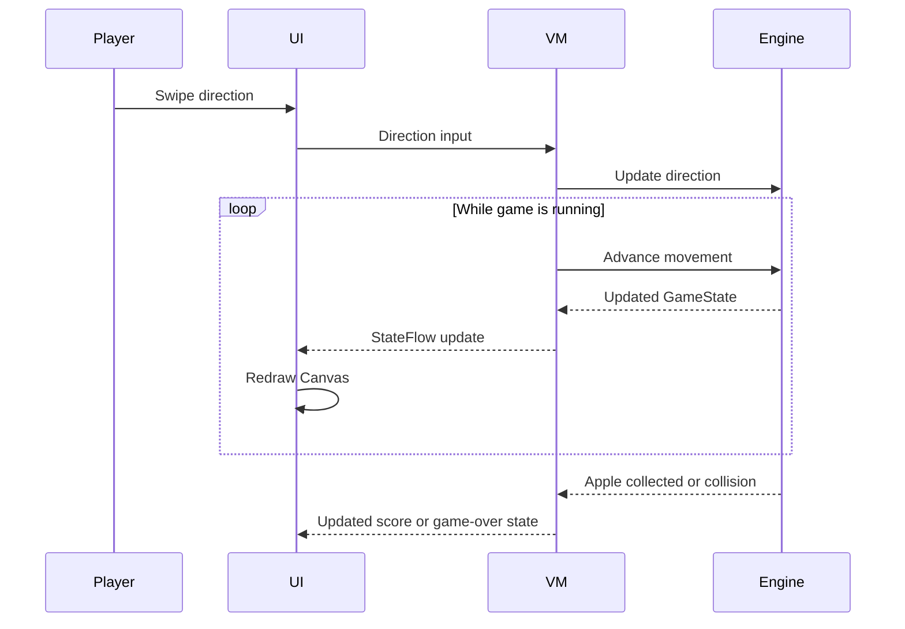
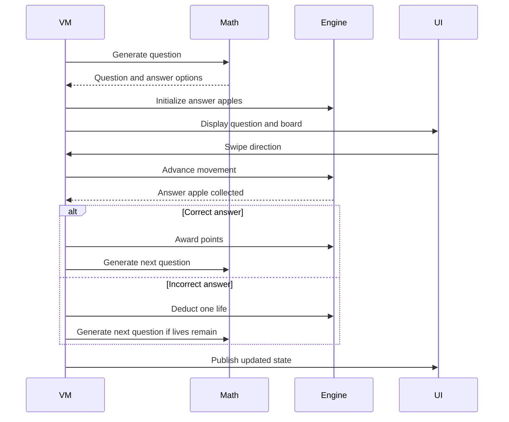

# Snake & Math — Android Game Project Handoff

**Document type:** Project Handoff  
**Project:** Snake & Math -- tentative title  
**Platform:** Native Android  
**Language:** Kotlin  
**UI Framework:** Jetpack Compose

---

# PART 1 — PROJECT OVERVIEW

## 1.1 Project Description

Snake & Math is a 2D Snake mobile game with two different gameplay modes:

1. **Classic Apple Mode** — Traditional Snake gameplay where the player collects apples to grow the snake and increase their score.
2. **MDAS Learning Mode** — An educational game that combines Snake mechanics with mathematical problem-solving. Players solve arithmetic questions and collect the correct answer from three apples.

The game will have a cute, playful cartoon visual identity featuring a green snake mascot.

The project is intended to be both a personal game and a portfolio project demonstrating Android development, software architecture, game logic, and UI development.

## 1.2 Confirmed Technology Decisions

| Component               | Technology               |
| ----------------------- | ------------------------ |
| Platform                | Android only             |
| Programming language    | Kotlin                   |
| IDE                     | Android Studio           |
| UI Framework            | Jetpack Compose          |
| Game rendering          | Compose Canvas           |
| Architecture            | MVVM                     |
| State management        | StateFlow                |
| Asynchronous operations | Kotlin Coroutines        |
| Local persistence       | Preferences DataStore    |
| Unit testing            | JUnit                    |
| UI testing              | Compose UI Testing       |
| Backend                 | None for initial release |

**Important:** Do not use React Native, Expo, or Flutter. The project will be developed as a native Android application using Kotlin.

## 1.3 Controls

The game will use **swipe gestures exclusively**.

- Swipe up to move upward.
- Swipe down to move downward.
- Swipe left to move left.
- Swipe right to move right.

There should be no directional buttons, virtual D-pad, or on-screen arrow controls.

A small instructional hint such as "SWIPE TO MOVE" can be displayed when the player starts.

---

# PART 2 — PRODUCT REQUIREMENTS DOCUMENT (PRD)

## 2.1 Game Modes

### Mode 1: Classic Apple

Traditional Snake gameplay.

**Gameplay:**

1. The snake moves continuously on a grid.
2. The player changes direction using swipe gestures.
3. An apple appears at a random unoccupied position.
4. The player guides the snake toward the apple.
5. When the snake eats an apple:
   - Score increases.
   - Snake grows longer.
   - Another apple appears.
6. The game ends when the snake collides with itself or a wall.

**Features:**

- Score tracking.
- Best score tracking.
- Pause and resume.
- Restart.
- Game-over screen.
- Local high-score persistence.

### Mode 2: MDAS Learning

An educational Snake game that teaches mathematical operations.

MDAS stands for:

- M — Multiplication
- D — Division
- A — Addition
- S — Subtraction

**Initial lives: 5**

**Gameplay flow:**

1. The player starts the MDAS game with five lives.
2. The game generates a mathematical question.
3. The question is displayed on the screen.
4. Three apples appear on the game board.
5. Each apple contains a numerical answer.
6. One apple contains the correct answer.
7. The other two apples contain incorrect answers.
8. The player controls the snake through swipe gestures to collect an answer apple.
9. The game evaluates the selected answer.

**Correct answer:**

- Increase the player's score.
- Proceed to the next mathematical question.
- Generate three new answer apples.

**Incorrect answer:**

- Deduct one life.
- Apply the agreed question progression rule.
- Continue while the player has remaining lives.

**Game over:**

- The game ends when the player loses all five lives.
- Display the final score and a retry option.

### Recommended MDAS Rules

These are proposed defaults and should be confirmed before implementation:

| Situation              | Recommended behavior                      |
| ---------------------- | ----------------------------------------- |
| Correct answer         | Increase score and generate next question |
| Incorrect answer       | Lose one life and generate next question  |
| Wall collision         | Lose one life and reset snake             |
| Self collision         | Lose one life and reset snake             |
| Lives reach zero       | Game over                                 |
| Question timer         | No timer initially                        |
| Answer apple placement | Random reachable positions                |
| Starting lives         | 5                                         |

The mathematical question should remain visible while the player controls the snake.

The three answer apples should be placed in positions that the snake can reasonably reach.

## 2.2 Mathematical Question Generation

The MDAS engine must follow standard mathematical precedence.

Example:

`5 + 3 × 2`

Correct answer: `11`

Multiplication and division must be evaluated before addition and subtraction.

Operators with equal precedence must be evaluated from left to right.

For the first release:

- Use integer operands.
- Prefer exact integer division.
- Avoid ambiguous expressions.
- Generate exactly one correct answer.
- Generate two distinct incorrect answers.
- Randomize the position of the correct answer.
- Validate every generated question before displaying it.

Potential future difficulty levels:

| Difficulty | Example             |
| ---------- | ------------------- |
| Easy       | 5 + 3 × 2           |
| Medium     | 24 ÷ 4 + 6 × 2      |
| Hard       | 45 - 6 × 3 + 24 ÷ 4 |

Difficulty progression can be implemented later.

## 2.3 Main Screens

### Home Screen

- Snake & Math title.
- Cartoon snake mascot.
- Classic Apple mode selection.
- MDAS Learning mode selection.
- Best scores.
- Settings.

### Classic Gameplay

- Current score.
- Best score.
- Pause control.
- Game board.
- Snake.
- Apple collectible.
- Swipe-to-move hint.

### MDAS Gameplay

- Current score.
- Five-life indicator.
- Mathematical question panel.
- Game board.
- Three answer apples containing numbers.
- Swipe-to-move hint.

### Pause Screen

- Resume.
- Restart.
- Return to home.

### Game Over Screen

- Final score.
- Best score.
- Retry.
- Return home.

### Settings

Potential settings:

- Sound effects.
- Music toggle.
- Other basic preferences.

Keep settings minimal for the first version.

## 2.4 Visual Design Requirements

Use the downloaded Snake & Math mockup image as the primary visual reference.

**Visual direction: Cute Cartoon / Modern Minimalist**

Characteristics:

- Deep forest-green background.
- Bright leaf-green and lime-green accents.
- Cute green cartoon snake.
- Darker green spots on the snake's body.
- Large expressive eyes.
- Friendly smiling face.
- Forked red tongue.
- Smooth rounded body.
- Red apple collectibles.
- Rounded UI panels.
- Playful but readable typography.

The snake should look like a continuous cartoon character rather than a collection of disconnected circles.

For gameplay, maintain grid-based logic but render the snake using smooth connected paths.

The MDAS answer apples should contain clearly readable numerical labels.

---

# PART 3 — TECHNICAL REQUIREMENTS DOCUMENT (TRD)

## 3.1 Recommended Architecture

Use **MVVM with a separate game engine/domain layer**.

The game engine should be independent of Jetpack Compose.

This allows:

- Easier unit testing.
- Separation of game rules and UI.
- Reusable gameplay mechanics between modes.
- Easier maintenance.
- Potential expansion of game modes.

## 3.2 Suggested Package Structure

```text
com.example.snakemath/
│
├── app/
│   ├── MainActivity.kt
│   ├── SnakeMathApp.kt
│   └── navigation/
│
├── core/
│   ├── model/
│   ├── game/
│   ├── math/
│   └── ui/
│       ├── theme/
│       ├── components/
│       └── drawing/
│
├── data/
│   ├── preferences/
│   └── repository/
│
├── feature/
│   ├── home/
│   ├── classic/
│   ├── mdas/
│   ├── settings/
│   └── results/
│
└── MainApplication.kt
```

Initially, a single Gradle application module is sufficient. We can split it into multiple Gradle modules when the project grows.

## 3.3 Core Components

### Game Engine

Responsible for:

- Snake movement.
- Direction changes.
- Collision detection.
- Apple spawning.
- Snake growth.
- Score calculation.
- Lives management.
- Game status.
- Game-state transitions.

### MDAS Engine

Responsible for:

- Mathematical expression generation.
- Expression evaluation.
- Mathematical precedence.
- Correct answer generation.
- Incorrect answer generation.
- Difficulty management.

### Game Renderer

Responsible for:

- Drawing the game board.
- Drawing the snake.
- Drawing snake spots.
- Drawing the snake head and facial features.
- Drawing apples.
- Drawing numerical labels.

Use Jetpack Compose Canvas.

### ViewModels

Responsible for:

- Managing screen state.
- Handling user actions.
- Connecting the UI to game logic.
- Managing game lifecycle.
- Exposing StateFlow to Compose.

### Data Layer

Responsible for:

- Saving Classic best score.
- Saving MDAS best score.
- Saving settings.
- Reading persisted preferences.

Use Preferences DataStore.

## 3.4 Suggested Domain Models

These are conceptual models, not finalized implementation code.

```kotlin
data class GridPoint(
    val x: Int,
    val y: Int
)

enum class Direction {
    UP,
    DOWN,
    LEFT,
    RIGHT
}

enum class GameMode {
    CLASSIC,
    MDAS
}

enum class GameStatus {
    READY,
    RUNNING,
    PAUSED,
    GAME_OVER,
    COMPLETED
}

data class AnswerOption(
    val id: String,
    val value: Int,
    val isCorrect: Boolean,
    val position: GridPoint
)

data class MathQuestion(
    val expression: String,
    val correctAnswer: Int,
    val options: List<AnswerOption>
)
```

The final GameState should contain the relevant state for the selected mode, including the snake, score, lives, food or answer options, and game status.

## 3.5 Game Loop

Use Kotlin Coroutines for the game loop.

Important requirements:

- Only one active game loop per session.
- Use a configurable tick interval.
- Stop the loop when the game is paused.
- Stop the loop when the app goes into the background.
- Cancel the loop when the ViewModel is cleared.
- Avoid multiple loops when resuming.
- Do not accumulate missed ticks while the app is backgrounded.

The game engine should process one movement tick at a time.

## 3.6 Swipe Gesture Detection

Use Compose pointer input gesture detection.

The gesture handler should:

1. Detect the swipe distance.
2. Determine the dominant horizontal or vertical direction.
3. Convert it to a Direction.
4. Send the direction to the ViewModel.
5. Let the game engine validate the direction.

Prevent immediate 180-degree reversals.

For example, if the snake is moving right, it should not immediately move left.

Use a pending-direction mechanism to handle rapid swipes between movement ticks.

## 3.7 Canvas Rendering

The game should use Compose Canvas for custom rendering.

Rendering responsibilities:

- Grid-to-pixel coordinate conversion.
- Snake body path.
- Smooth body curves.
- Snake spots.
- Snake head.
- Eyes and facial details.
- Forked tongue.
- Apples.
- Answer numbers.

The snake's logical body remains grid-based, but its appearance should use connected rounded paths.

The renderer must not contain game rules or collision logic.

## 3.8 Collision Detection

The engine should handle:

- Wall collision.
- Self collision.
- Apple collection.
- Answer apple collection.

Important edge case:

If the snake is not growing, its tail moves away during the next tick. Therefore, moving into the current tail cell can be legal.

If the snake is growing, the tail remains in place, so moving into that cell is a collision.

This should be covered by unit tests.

## 3.9 Persistence

Use Preferences DataStore.

Persist:

- Classic best score.
- MDAS best score.
- Sound preferences.
- Difficulty preference, if introduced.

Do not persist active gameplay sessions in the first release.

---

# PART 4 — SYSTEM ARCHITECTURE

## 4.1 High-Level Architecture



## 4.2 Classic Mode Flow



## 4.3 MDAS Mode Flow



## 4.4 Architectural Rules

- UI must not implement game rules.
- Canvas must only render the game state.
- ViewModels manage observable state and lifecycle.
- Game Engine handles movement and collision.
- MDAS Engine handles mathematical logic.
- Data layer handles local persistence.
- Domain/game logic must not depend on Compose.

---

# PART 5 — TESTING REQUIREMENTS

## Game Engine Tests

- Snake movement.
- Direction changes.
- Reverse-direction prevention.
- Snake growth.
- Wall collision.
- Self collision.
- Tail-cell collision edge case.
- Apple spawning.
- Score calculation.
- Pause and resume.
- Full-board completion.

## MDAS Tests

- Correct mathematical precedence.
- Left-to-right evaluation.
- Exact division.
- Question generation.
- Exactly one correct answer.
- Two distinct incorrect answers.
- Randomized correct answer position.
- Starting lives equal five.
- Correct answer scoring.
- Incorrect answer life deduction.
- Game over at zero lives.

## UI Tests

- Home screen navigation.
- Classic mode selection.
- MDAS mode selection.
- Swipe gesture detection.
- No directional buttons displayed.
- Pause/resume.
- Game-over navigation.
- MDAS question and answer visibility.

---

# PART 6 — DEVELOPMENT ROADMAP

## Milestone 0 — Product Discovery and Technical Planning

Finalize:

- MDAS gameplay rules.
- Difficulty progression.
- Portrait/landscape decision.
- Score system.
- Collision behavior.
- Visual design details.

Do not begin implementation until the core requirements are clear.

## Milestone 1 — Android Project Foundation

- Create Kotlin Android project.
- Configure Jetpack Compose.
- Establish package structure.
- Create application theme.
- Implement navigation.
- Create basic home screen.

## Milestone 2 — Classic Game Engine

- Implement grid system.
- Implement snake movement.
- Implement direction handling.
- Implement apple spawning.
- Implement growth.
- Implement collision detection.
- Implement scoring.
- Write unit tests.

## Milestone 3 — Custom Snake Rendering

- Implement Canvas board.
- Draw continuous snake body.
- Draw snake spots.
- Draw snake head and face.
- Draw apples.
- Match the downloaded visual reference.

## Milestone 4 — Classic Gameplay UI

- Connect game engine to Compose.
- Implement swipe gestures.
- Implement score display.
- Implement pause/resume.
- Implement game-over screen.
- Save best score using DataStore.

## Milestone 5 — MDAS Engine

- Implement mathematical expression generation.
- Implement expression evaluation.
- Implement answer generation.
- Implement distractor generation.
- Implement five-life system.
- Implement scoring.
- Write unit tests.

## Milestone 6 — MDAS Gameplay UI

- Display mathematical question.
- Display three answer apples.
- Add numerical labels.
- Implement correct/wrong answer handling.
- Display remaining lives.
- Implement results screen.

## Milestone 7 — Polish and Quality Assurance

- Test lifecycle behavior.
- Improve animations.
- Improve swipe responsiveness.
- Verify different screen sizes.
- Improve accessibility.
- Optimize rendering if necessary.
- Finalize portfolio documentation.

---

# PART 7 — PROJECT SCOPE

## Included in Version 1

- Android-only application.
- Kotlin.
- Jetpack Compose.
- Custom Canvas rendering.
- Classic Snake mode.
- MDAS Learning mode.
- Five-life system.
- Three answer apples.
- Swipe-only controls.
- Local high scores.
- Settings.
- Unit and UI testing.

## Excluded Unless Added Later

- iOS.
- Backend.
- User accounts.
- Cloud synchronization.
- Multiplayer.
- Online leaderboards.
- Advertisements.
- In-app purchases.
- Teacher dashboards.
- 3D graphics.
- Directional buttons.

---

# PART 8 — INSTRUCTIONS FOR THE NEXT CHATGPT CONVERSATION

You are continuing development of my personal Android game project called **Snake & Math**.

I have provided:

1. This project handoff document.
2. A downloaded UI mockup image that serves as the visual reference.

Read the entire document and inspect the uploaded image before proceeding.

## Important Instructions

- We are building a native Android application using Kotlin.
- Use Jetpack Compose and Compose Canvas.
- Do not switch to React Native, Expo, or Flutter.
- Controls must use swipe gestures only.
- There are two game modes: Classic Apple and MDAS Learning.
- MDAS starts with five lives and uses three answer apples, with one correct answer and two incorrect answers.
- Preserve the cartoon green snake visual direction from the uploaded mockup.

## Development Approach

I want to understand the engineering decisions, not simply receive code.

When guiding me:

- Explain each command before asking me to execute it.
- Explain why we are choosing a particular library or architecture.
- Walk through the implementation step by step.
- Explain important Kotlin and Android concepts.
- Avoid jumping ahead to future milestones.
- Prefer clean, maintainable, testable code.
- Include unit tests where appropriate.
- Do not dump an entire application implementation at once.

## Where to Continue

Start with **Milestone 0 — Product Discovery and Technical Planning**.

First, review the project requirements and identify unresolved product decisions.

Ask me the most important clarification questions before finalizing the detailed requirements.

Do not start coding until Milestone 0 is complete and I explicitly approve moving forward.
